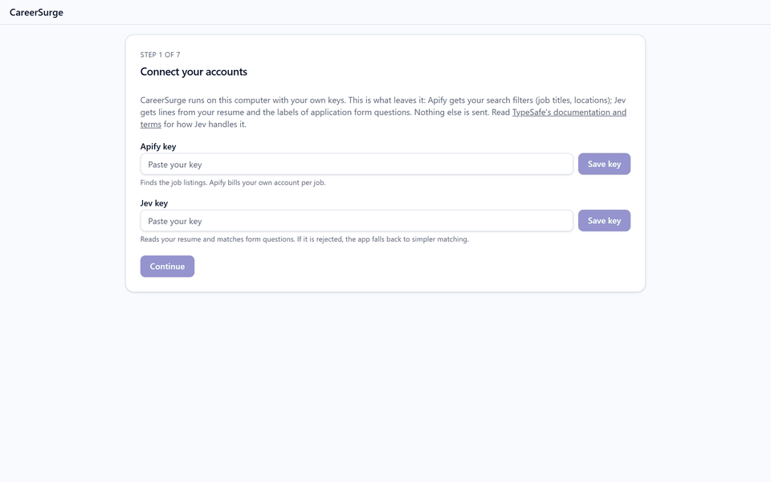

# CareerSurge

A free desktop app that finds job postings and applies to them for you, on your own computer.



> **Local-first.** No CareerSurge server, no CareerSurge account, no telemetry. Your profile, answers and application history
> live in a SQLite file on your computer, and they are yours. The app connects only to Apify (with your own key, to
> find listings), to TypeSafe (only if you add a Jev key) and to the job pages you approve.

## Quick start

### Prerequisites

The install scripts don't check these, so make sure each one is in place first:

- **Python 3.12, 3.13 or 3.14.** Not 3.15 or newer yet: one of the app's packages has no build for it, and the
  install fails.
  - macOS and Linux: `python3 --version` must print one of those versions.
  - Windows: install it from [python.org](https://www.python.org/downloads/), which includes the `py` launcher. The
    script asks for 3.12 by name, so `py -3.12 --version` must work.
  - Debian and Ubuntu also need the venv package: `sudo apt install python3-venv`.
- **Node.js 22 or newer**, from [nodejs.org](https://nodejs.org/): `node --version` must print v22 or higher. npm
  comes with it.
- **git**: `git --version` must work.
- **Linux only**: the libraries for the window and the browser. On Ubuntu, `sudo apt install libxcb-cursor0`. After
  the first run, also run `sudo backend/venv/bin/python -m playwright install-deps chromium`.

### Install and start

**macOS and Linux:**
```
git clone https://github.com/Ben19001/careersurge && cd careersurge && ./run.sh
```

**Windows** (PowerShell):
```
git clone https://github.com/Ben19001/careersurge; cd careersurge; powershell -ExecutionPolicy Bypass -File run.ps1
```

The first run installs everything into the `careersurge` folder, which takes a few minutes, then opens the app at
onboarding.
- **To start it later**, run only the script part from the `careersurge` folder: `./run.sh`, or
  `powershell -ExecutionPolicy Bypass -File run.ps1`. It skips the install.
- **After a `git pull`**, add `--update` once to reinstall. Put it first, before any other option: `./run.sh --update`.
- **If the first install stopped partway**, run the script again; it starts the install over. If it fails the same way,
  delete the `backend/venv` folder and run it once more.
- **If you upgrade or remove the Python the app was installed with**, or the app stops starting with a Python error,
  delete the `backend/venv` folder and run the script again. The scripts don't check the Python they installed with.
- **Add `--no-window`** to get a URL you open in your own browser instead of a window.

`-ExecutionPolicy Bypass` doesn't give the script administrator rights. Windows doesn't run `.ps1` files by default,
and Bypass allows only this one run, with no setting changed. The script runs as you, like any program you start.
Neither script needs administrator rights or `sudo`.

## About

CareerSurge searches for listings that match your titles and locations, shows you a batch to approve, and then
fills and submits each application form for you in a headless Chromium. Everything stays on your machine: the
app is a small local server with a desktop window, and your profile, answers and history live in a SQLite file
in your user data folder.

It supports three applicant tracking systems: **Greenhouse**, **Lever** and **Ashby**.

What it will not do:
- **No evasion.** There is no captcha solving, no stealth browser, no proxy rotation and no rotating email
  aliases. When a form needs a captcha, a one-time code or an email link, the application waits in **Needs you**
  and you finish it yourself.
- **No made-up answers.** Every value it puts on a form comes from your profile, an answer you saved, a consent
  you gave, or the form's own decline option. A question it can't answer that way goes to Needs you.
- **No double applying.** It never applies to the same listing twice, and it warns you about a likely repost.

## Setup: the two keys

The app uses keys you supply, and stores them in your operating system's keychain (Keychain on macOS,
Credential Manager on Windows, Secret Service on Linux). Where there is no keychain, it keeps them in
`secrets.json` in the data folder. You enter both in the onboarding screens, and can change them in Settings.

- **Apify** (required for finding jobs). Listings come from an Apify actor, `fantastic-jobs/career-site-job-listing-api`.
  The app sends Apify your search filters (job titles, locations and the optional filters you set). Apify bills
  each run to **your own Apify account**. Before the first charge the app shows you the price Apify quotes and
  asks you to confirm it, and it never starts a run that would go past the monthly budget you set.
- **Jev** (optional, from TypeSafe). Jev only ever *picks* among values the app already found; it never writes
  an answer. The app sends it your resume text (to pick your name, email and so on from the lines it found),
  form field labels (to match them to your profile), and a question's text with the company name (to sort
  questions that need you). Without a Jev key, or when TypeSafe refuses it, the app falls back to its own
  matching and asks you more often.

For development and CI, an environment variable of the same name (`APIFY_TOKEN`, `JEV_API_KEY`) wins over the
keychain.

## Install by hand

`run.sh` and `run.ps1` do these steps for you. They are here if you'd rather run them yourself, or if a script
stops with an error. The prerequisites are the same (see Quick start).

1. **The desktop window toolkit**, used by [pywebview](https://pywebview.flowrl.com/):
   - **Windows:** Microsoft Edge WebView2, which Windows 10 and 11 already include.
   - **macOS:** nothing extra.
   - **Linux:** GTK or Qt with Python bindings inside the app's virtual environment. The simplest is Qt from pip:
     after step 3, run `venv/bin/pip install "pywebview[qt]"`. Without a toolkit, use `--no-window` (below).
2. **The interface:**
   ```
   cd frontend
   npm ci
   npm run build
   ```
3. **The app and its browser:**
   ```
   cd backend
   python -m venv venv
   venv/bin/pip install -r requirements.txt          # Windows: venv\Scripts\pip install -r requirements.txt
   venv/bin/python -m playwright install chromium     # Windows: venv\Scripts\python -m playwright install chromium
   ```
4. **Start it** from `backend/`:
   ```
   venv/bin/python -m app.local_main                  # Windows: venv\Scripts\python -m app.local_main
   ```
   A window opens at onboarding. With `--no-window` the app prints a URL instead, which you open in your own
   browser. That URL holds the session's access token, so don't share it.

Only one copy runs at a time. Closing the window while an application is being submitted asks you first.

## Your data

The database, your resume and any saved keys live in your user data folder, from
[platformdirs](https://pypi.org/project/platformdirs/): for example `%LOCALAPPDATA%\CareerSurge` on Windows,
`~/Library/Application Support/CareerSurge` on macOS and `~/.local/share/CareerSurge` on Linux.
`CAREERSURGE_DATA_DIR` overrides the location.

The database is **not encrypted**. Anyone who can read files in your user account can read your profile and
application history. The app talks only to Apify, to TypeSafe when you set a Jev key, and to the application
pages of the jobs you approved.

## Disclaimer

- The software is provided **as is**, without warranty of any kind (see `LICENSE`).
- **Submissions are real.** Every application you approve is sent to a real employer under your name.
- Automated applying may breach an applicant tracking system's or employer's terms of use. You are responsible
  for how you use it.
- CareerSurge is not affiliated with Greenhouse, Lever, Ashby, Apify or TypeSafe.
- Apify charges your own account for every run. The app shows the price before charging, but you are billed by
  Apify, not by this project.
- Nothing here is legal advice.

## Contributing and security

See `CONTRIBUTING.md` for the tests and checks, and `SECURITY.md` to report a vulnerability.

## License

Apache License 2.0. See `LICENSE`.
